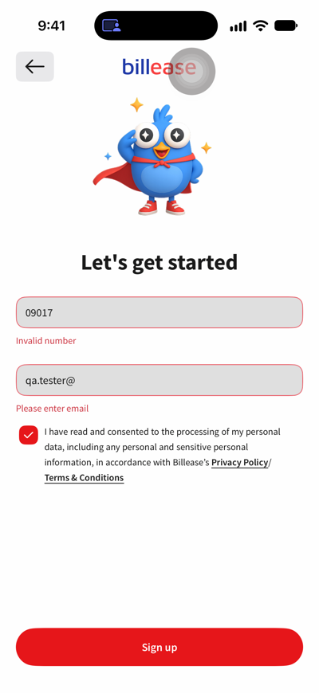
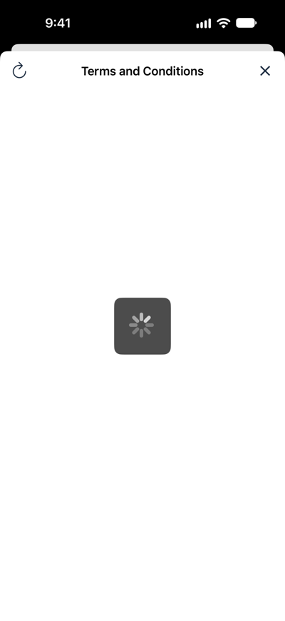
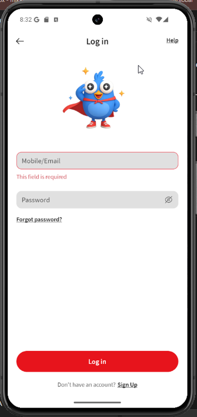
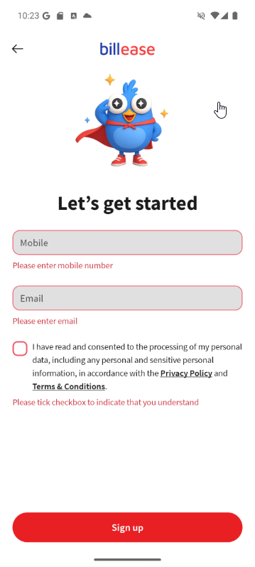

# Bugs

**Environment:** Pixel 8 emulator, Android 15 (API 35), Google Play build · iPhone 18 Pro, iOS 27.0.1, App Store build 4.72.0
**Reported:** 21 to 23 Nov 2026 · **Results:** [TEST_REPORT.md](TEST_REPORT.md)

| Key | Summary | Android | iOS | Severity | Priority | Status |
|---|---|:---:|:---:|---|---|---|
| [BUG-001](#bug-001) | Sign Up: invalid email shows "Please enter email" | ✅ | ❌ | Medium | P2 | Open |
| [BUG-002](#bug-002) | Sign Up: Terms & Conditions page does not load | ✅ | ❌ | Medium | P2 | Open |
| [BUG-003](#bug-003) | Error messages differ between Android and iOS | ❌ | ❌ | Low | P3 | Open |
| [BUG-004](#bug-004) | Empty field message differs between Login and Forgot Password | ❌ | ✅ | Low | P3 | Open |
| [BUG-005](#bug-005) | Forgot Password: unregistered email opens ID-based Account recovery | ❌ | ❌ | Low | P3 | Needs clarification |
| [BUG-006](#bug-006) | Account recovery: Cancel returns to landing screen | ❌ | ❌ | Low | P3 | Needs clarification |
| [BUG-007](#bug-007) | Login: fields are validated one at a time | ❌ | ❌ | Low | P4 | Open |
| [BUG-008](#bug-008) | Account recovery: image has no accessibility label | ❌ | ✅ | Low | P4 | Open |

✅ not affected · ❌ affected
**Severity:** Medium = wrong or missing information on a main flow. Low = inconsistency, UX or accessibility.
**Priority:** P2 fix before release · P3 next sprint · P4 backlog

---

## BUG-001 · Sign Up: invalid email shows "Please enter email"

| Type | Severity | Priority | Platform | Component | Test case | Status |
|---|---|---|---|---|---|---|
| Bug | Medium | P2 | iOS | Sign Up | SGN-004 | Open |

**Description**
On iOS, an email without a domain triggers the empty-field message instead of the invalid-format message. The user is told to enter an email they already entered.

**Steps to reproduce**
1. Open Sign up
2. Enter mobile `09017` and email `qa.tester@`
3. Tick consent, tap Sign up

**Expected:** "Invalid email address"
**Actual:** "Please enter email"
**Reproducibility:** Always (automated test fails on every iOS run)

**Evidence**

| Android (correct) | iOS |
|---|---|
|  |  |

Page source: [SGN-004 iOS](evidence/page-sources-ios/SGN-004_shows_an_error_for_an_invalid_email_negative.xml)

**Clarification (Dev):** Does iOS run the "required" check after trimming or parsing the value? `qa.tester@` may be treated as empty by the iOS validator.

---

## BUG-002 · Sign Up: Terms & Conditions page does not load

| Type | Severity | Priority | Platform | Component | Test case | Status |
|---|---|---|---|---|---|---|
| Bug | Medium | P2 | iOS | Sign Up | SGN-008 | Open |

**Description**
The Terms & Conditions link opens an in-app sheet that shows a spinner and then stays blank. Users are asked to consent to terms they cannot read.

**Steps to reproduce**
1. Open Sign up
2. Tap Terms & Conditions

**Expected:** Terms and Conditions document loads.
**Actual:** Spinner, then a blank page. Reload does not help.
**Reproducibility:** Every attempt
**Notes:** Privacy Policy on the same screen loads fine. Both documents load on Android.

**Evidence**

| iOS |
|---|
|  |

Recording: [Drive folder](https://drive.google.com/drive/folders/1d2D7QG8Q_hgE5EYkZ8dmdkdj6ti_2TWt?usp=sharing)

**Clarification (Dev):** Is the iOS app using a different Terms URL than Android, or one that blocks embedding in a web view?

---

## BUG-003 · Error messages differ between Android and iOS

| Type | Severity | Priority | Platform | Component | Test case | Status |
|---|---|---|---|---|---|---|
| Bug | Low | P3 | Both | Login, Forgot Password | LGN-005, FPW-002 | Open |

**Description**
The same input produces different error text on each platform.

| Case | Android | iOS |
|---|---|---|
| Forgot Password, empty field, tap Reset | "Please enter a valid email or mobile number." | "This field is required" |
| Log in with mobile `0917123` | "Invalid email or mobile" | "This is not a valid phone number" |

**Expected:** Same message on both platforms.

**Evidence**

| FPW-002 Android | FPW-002 iOS | LGN-005 Android | LGN-005 iOS |
|---|---|---|---|
|  |  |  |  |

**Clarification (BA/UX):** Which wording is the approved copy?

---

## BUG-004 · Empty field message differs between Login and Forgot Password

| Type | Severity | Priority | Platform | Component | Test case | Status |
|---|---|---|---|---|---|---|
| Bug | Low | P3 | Android | Login, Forgot Password | LGN-004, FPW-002 | Open |

**Description**
An empty required field shows "This field is required" on Log in but "Please enter a valid email or mobile number." on Forgot Password. iOS uses "This field is required" on both.

**Steps to reproduce**
1. Open Log in, tap Log in with empty fields
2. Open Forgot password, tap Reset with the field empty

**Expected:** Same message on both screens.
**Actual:** Different messages.

**Evidence**

| Log in | Forgot Password |
|---|---|
|  |  |

---

## BUG-005 · Forgot Password: unregistered email opens ID-based Account recovery

| Type | Severity | Priority | Platform | Component | Test case | Status |
|---|---|---|---|---|---|---|
| Improvement | Low | P3 | Both | Forgot Password | FPW-004 | Needs clarification |

**Description**
Entering an email that is not registered takes the user straight to Account recovery, which asks them to prepare an ID. A user who mistyped their email has no way to correct it from there.

**Steps to reproduce**
1. Open Log in, tap Forgot password?
2. Enter `qa.tester@example.com`, tap Reset

**Expected:** "No account found" message with an option to try again.
**Actual:** Account recovery screen with Continue and Cancel.

**Evidence**

| Android | iOS |
|---|---|
|  |  |

**Clarification (BA):** Is this intentional to avoid revealing which emails are registered? If yes, close as "Works as designed" and document it.

---

## BUG-006 · Account recovery: Cancel returns to landing screen

| Type | Severity | Priority | Platform | Component | Test case | Status |
|---|---|---|---|---|---|---|
| Improvement | Low | P3 | Both | Forgot Password | FPW-005 | Needs clarification |

**Description**
Tapping Cancel on Account recovery skips Forgot Password and Log in and returns to the landing screen.

**Steps to reproduce**
1. Follow BUG-005
2. Tap Cancel

**Expected:** Back to Forgot Password so the user can correct the email.
**Actual:** Landing screen.

**Clarification (BA):** Which screen should Cancel return to?

---

## BUG-007 · Login: fields are validated one at a time

| Type | Severity | Priority | Platform | Component | Test case | Status |
|---|---|---|---|---|---|---|
| Improvement | Low | P4 | Both | Login | LGN-004, LGN-007 | Open |

**Description**
With both fields empty, only Mobile/Email shows an error. The Password error appears only after Mobile/Email is filled and Log in is tapped again. Sign Up shows all errors at once.

**Steps to reproduce**
1. Open Log in, tap Log in with both fields empty
2. Fill Mobile/Email, tap Log in again

**Expected:** Errors on both fields after step 1.
**Actual:** Error on Mobile/Email only. Password error appears after step 2.

**Evidence**

| Log in (one error) | Sign Up (all errors) |
|---|---|
|  |  |

---

## BUG-008 · Account recovery: image has no accessibility label

| Type | Severity | Priority | Platform | Component | Test case | Status |
|---|---|---|---|---|---|---|
| Bug | Low | P4 | Android | Forgot Password | FPW-004 | Open |

**Description**
The mascot image on Account recovery has an empty `content-desc`. TalkBack announces it as an unlabelled image. iOS labels it `billyInstructions`.

**Expected:** Image has a label, or is marked decorative and hidden from screen readers.
**Actual:** No label.

**Evidence:** Android page source, `android.widget.ImageView` with `content-desc=""` on the Account recovery screen.
