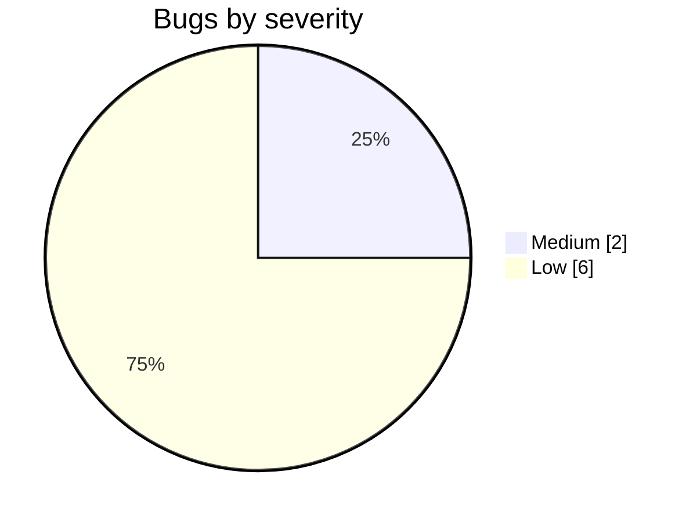
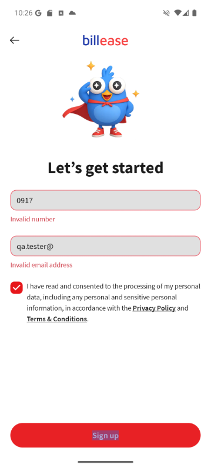
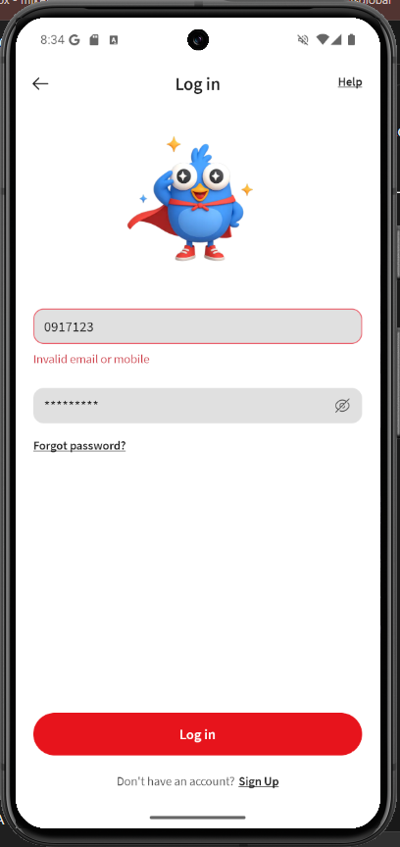
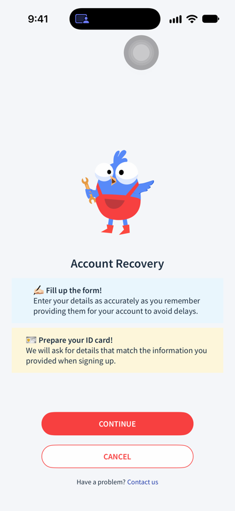

# Bug Report

| | |
|---|---|
| **App** | BillEase (Android: Google Play build · iOS: App Store build 4.72.0) |
| **Devices** | Pixel 8 emulator, Android 15 (API 35) · iPhone 18 Pro, iOS 27.0.1 (real device) |
| **Tested** | 21–22 Nov 2026 |
| **Data** | Fake data only (see [TEST_CASES.md](TEST_CASES.md)). No account was created. |

## Overview

| ID | Title | Android | iOS | Severity | Test case |
|---|---|:---:|:---:|---|---|
| [BUG-001](#bug-001-invalid-email-on-sign-up-shows-please-enter-email) | Invalid email on Sign Up shows "Please enter email" | ✅ | ❌ | 🟠 Medium | SGN-004 |
| [BUG-002](#bug-002-terms--conditions-page-stays-blank) | Terms & Conditions page stays blank | ✅ | ❌ | 🟠 Medium | SGN-008 |
| [BUG-003](#bug-003-same-error-shows-different-text-on-android-and-ios) | Same error shows different text on Android and iOS | ⚠️ | ⚠️ | 🟢 Low | FPW-002, LGN-005 |
| [BUG-004](#bug-004-empty-field-message-differs-between-login-and-forgot-password) | Empty-field message differs between Login and Forgot Password | ❌ | ✅ | 🟢 Low | LGN-004, FPW-002 |
| [BUG-005](#bug-005-unregistered-email-goes-straight-to-id-based-account-recovery) | Unregistered email goes straight to ID-based Account recovery | ❌ | ❌ | 🟢 Low | FPW-004 |
| [BUG-006](#bug-006-cancel-on-account-recovery-jumps-to-the-landing-screen) | Cancel on Account recovery jumps to the landing screen | ❌ | ❌ | 🟢 Low | FPW-005 |
| [BUG-007](#bug-007-login-shows-one-error-at-a-time-sign-up-shows-all) | Login shows one error at a time, Sign Up shows all | ❌ | ❌ | 🟢 Low | LGN-004, SGN-002 |
| [BUG-008](#bug-008-account-recovery-mascot-image-has-no-accessibility-label) | Account recovery mascot image has no accessibility label | ❌ | ✅ | 🟢 Low | FPW-004 |

❌ affected · ✅ works correctly · ⚠️ differs between platforms



**Severity:** 🟠 **Medium**: wrong or missing information that can block or confuse the user. 🟢 **Low**: inconsistency or UX issue; the user can still continue.

---

## BUG-001: Invalid email on Sign Up shows "Please enter email"

`iOS only` · `Medium` · Test case **SGN-004** (automated, fails on iOS)

**Steps**
1. Open the app > **Sign up**
2. Mobile: `09017`, Email: `qa.tester@`
3. Tick the consent checkbox, tap **Sign up**

**Expected:** "Invalid email address" under the Email field.
**Actual (iOS):** "Please enter email", as if the field were empty, even though it clearly has text in it.

**Why it matters:** The message is misleading. The user did enter an email, and the app doesn't tell them what's wrong with it.

<table>
  <tr><th>Android ✅</th><th>iOS ❌</th></tr>
  <tr>
    <td></td>
    <td></td>
  </tr>
  <tr><td>"Invalid email address"</td><td>"Please enter email"</td></tr>
</table>

Page source: [SGN-004 iOS](evidence/page-sources-ios/SGN-004_shows_an_error_for_an_invalid_email_negative.xml) (`email-text-field` value is `qa.tester@`, error label is `Please enter email`).

---

## BUG-002: Terms & Conditions page stays blank

`iOS only` · `Medium` · Test case **SGN-008** (manual)

**Steps**
1. Open the app > **Sign up**
2. Tap **Terms & Conditions** in the consent text

**Expected:** The Terms and Conditions document loads.
**Actual:** A "Terms and Conditions" sheet opens with a loading spinner. When the spinner stops, the page stays blank. The reload button doesn't help. Happens every time.

**Notes:** **Privacy Policy** on the same screen loads fine, so the connection is OK and only the Terms link is affected. On Android, Terms & Conditions loads without issues.

**Why it matters:** The user is asked to consent to terms they can't read.

<table>
  <tr><th>iOS ❌</th></tr>
  <tr><td></td></tr>
</table>

Screen recording: in the [recordings folder](https://drive.google.com/drive/folders/1d2D7QG8Q_hgE5EYkZ8dmdkdj6ti_2TWt?usp=sharing)

---

## BUG-003: Same error shows different text on Android and iOS

`Both` · `Low` · Test cases **FPW-002**, **LGN-005**

The same situation shows a different message depending on the platform.

| Case | Android | iOS |
|---|---|---|
| Forgot password, empty field, tap **Reset** | "Please enter a valid email or mobile number." | "This field is required" |
| Login with mobile `0917123` | "Invalid email or mobile" | "This is not a valid phone number" |

<table>
  <tr><th>FPW-002 Android</th><th>FPW-002 iOS</th><th>LGN-005 Android</th><th>LGN-005 iOS</th></tr>
  <tr>
    <td></td>
    <td></td>
    <td></td>
    <td></td>
  </tr>
</table>

**Expected:** One wording per situation, on both platforms.

---

## BUG-004: Empty-field message differs between Login and Forgot Password

`Android` · `Low` · Test cases **LGN-004**, **FPW-002**

**Steps**
1. Login: tap **Log in** with both fields empty → "This field is required"
2. Forgot password: tap **Reset** with the field empty → "Please enter a valid email or mobile number."

**Expected:** The same message for an empty required field on every screen. iOS already uses "This field is required" on both.

<table>
  <tr><th>Login (empty)</th><th>Forgot password (empty)</th></tr>
  <tr>
    <td></td>
    <td></td>
  </tr>
</table>

---

## BUG-005: Unregistered email goes straight to ID-based Account recovery

`Both` · `Low (UX)` · Test case **FPW-004**

**Steps**
1. Login > **Forgot password?**
2. Enter `qa.tester@example.com` (not registered), tap **Reset**

**Expected:** A message that no account was found for this email, with an option to try again or sign up.
**Actual:** The app opens Account recovery and asks the user to prepare an ID card. Someone who simply mistyped their email ends up in an ID verification flow.

<table>
  <tr><th>Android</th><th>iOS</th></tr>
  <tr>
    <td></td>
    <td></td>
  </tr>
</table>

---

## BUG-006: Cancel on Account recovery jumps to the landing screen

`Both` · `Low (UX)` · Test case **FPW-005**

**Steps:** From BUG-005, tap **Cancel**.

**Expected:** Back to the Forgot password screen, so the user can correct the email.
**Actual:** The app goes all the way back to the landing screen, and the user has to start over (Log in > Forgot password?).

---

## BUG-007: Login shows one error at a time, Sign Up shows all

`Both` · `Low (UX)` · Test cases **LGN-004**, **LGN-007**, **SGN-002**

**Steps**
1. Login: tap **Log in** with both fields empty → only Mobile/Email shows an error.
2. Fill in Mobile/Email, tap **Log in** again → only now does Password show "This field is required".
3. Sign Up: tap **Sign up** with everything empty → all three errors show at once.

Checked by hand on both Android and iOS.

**Expected:** The same validation style on both forms. Showing all errors at once saves the user a round trip.

<table>
  <tr><th>Login: one error</th><th>Sign Up: all errors</th></tr>
  <tr>
    <td></td>
    <td></td>
  </tr>
</table>

---

## BUG-008: Account recovery mascot image has no accessibility label

`Android` · `Low (accessibility)` · Found while inspecting **FPW-004**

**Details:** In the Account recovery screen's UI tree, the mascot image has an empty `content-desc`, so a screen reader announces it as an unlabelled image. On iOS the same image has a label (`billyInstructions`).

```xml
<!-- Android -->
<android.widget.ImageView content-desc="" ... />
<!-- iOS -->
<XCUIElementTypeImage name="billyInstructions" label="billyInstructions" ... />
```

**Expected:** Decorative images are hidden from screen readers, or have a meaningful label.

---

## Not bugs, but worth knowing

- **iOS restores the last screen after the app restarts.** Fine for users, but tests can't assume a fresh start on iOS. The suite handles this by going back to the landing screen before each test (see README).
- **Account recovery title differs slightly:** "Account recovery" on Android, "Account Recovery" on iOS.
