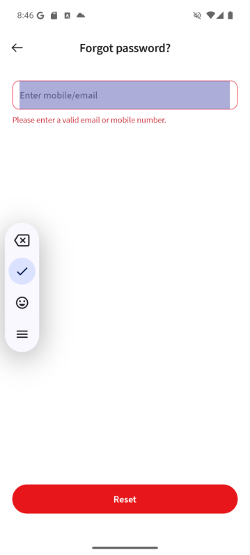
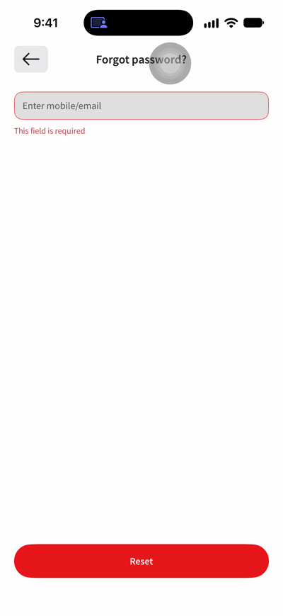
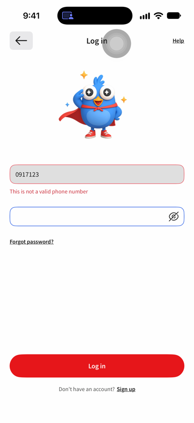
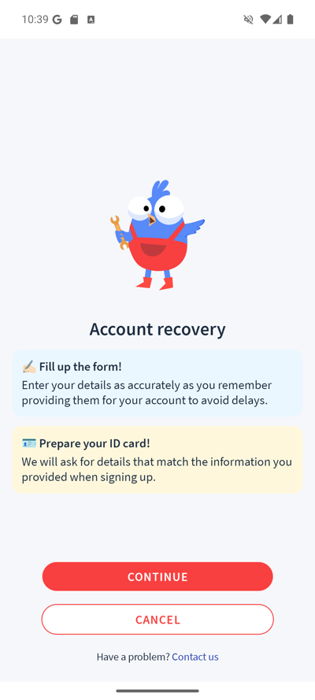

# Bug Report

**Environment:** Pixel 8 emulator, Android 15 (API 35), Google Play build · iPhone 18 Pro, iOS 27.0.1, App Store build 4.72.0
**Tested:** 21 to 23 Nov 2026

## Summary

| ID | Title | Android | iOS | Severity | Test case |
|---|---|:---:|:---:|---|---|
| [BUG-001](#bug-001) | Invalid email on Sign Up shows "Please enter email" | ✅ | ❌ | Medium | SGN-004 |
| [BUG-002](#bug-002) | Terms & Conditions page does not load | ✅ | ❌ | Medium | SGN-008 |
| [BUG-003](#bug-003) | Error messages differ between Android and iOS | ❌ | ❌ | Low | FPW-002, LGN-005 |
| [BUG-004](#bug-004) | Empty field message differs between Login and Forgot Password | ❌ | ✅ | Low | LGN-004, FPW-002 |
| [BUG-005](#bug-005) | Unregistered email opens ID-based Account recovery | ❌ | ❌ | Low | FPW-004 |
| [BUG-006](#bug-006) | Cancel on Account recovery returns to landing screen | ❌ | ❌ | Low | FPW-005 |
| [BUG-007](#bug-007) | Login validates one field at a time | ❌ | ❌ | Low | LGN-004, LGN-007 |
| [BUG-008](#bug-008) | Account recovery image has no accessibility label | ❌ | ✅ | Low | FPW-004 |

✅ not affected · ❌ affected

---

## BUG-001: Invalid email on Sign Up shows "Please enter email"

**Platform:** iOS · **Severity:** Medium · **Test case:** SGN-004

**Steps**
1. Open Sign up
2. Enter mobile `09017` and email `qa.tester@`
3. Tick consent, tap Sign up

**Expected:** "Invalid email address"
**Actual:** "Please enter email", although the field is not empty. Android shows the correct message.

| Android | iOS |
|---|---|
|  |  |

Page source: [SGN-004 iOS](evidence/page-sources-ios/SGN-004_shows_an_error_for_an_invalid_email_negative.xml)

---

## BUG-002: Terms & Conditions page does not load

**Platform:** iOS · **Severity:** Medium · **Test case:** SGN-008

**Steps**
1. Open Sign up
2. Tap Terms & Conditions

**Expected:** Terms and Conditions document loads.
**Actual:** Spinner, then a blank page. Reload does not help. Reproducible every time. Privacy Policy loads fine, and both load on Android.

| iOS |
|---|
|  |

Recording: [Drive folder](https://drive.google.com/drive/folders/1d2D7QG8Q_hgE5EYkZ8dmdkdj6ti_2TWt?usp=sharing)

---

## BUG-003: Error messages differ between Android and iOS

**Platform:** Both · **Severity:** Low · **Test cases:** FPW-002, LGN-005

| Case | Android | iOS |
|---|---|---|
| Forgot password, empty field | "Please enter a valid email or mobile number." | "This field is required" |
| Log in with mobile `0917123` | "Invalid email or mobile" | "This is not a valid phone number" |

**Expected:** Same message on both platforms.

| FPW-002 Android | FPW-002 iOS | LGN-005 Android | LGN-005 iOS |
|---|---|---|---|
|  |  |  |  |

---

## BUG-004: Empty field message differs between Login and Forgot Password

**Platform:** Android · **Severity:** Low · **Test cases:** LGN-004, FPW-002

**Steps**
1. Log in screen, tap Log in with empty fields: "This field is required"
2. Forgot password screen, tap Reset with empty field: "Please enter a valid email or mobile number."

**Expected:** One message for an empty required field. iOS uses "This field is required" on both.

| Log in | Forgot password |
|---|---|
|  |  |

---

## BUG-005: Unregistered email opens ID-based Account recovery

**Platform:** Both · **Severity:** Low · **Test case:** FPW-004

**Steps**
1. Log in, tap Forgot password?
2. Enter `qa.tester@example.com` (not registered), tap Reset

**Expected:** "No account found" message with an option to retry.
**Actual:** Account recovery opens and asks the user to prepare an ID. A mistyped email sends the user into ID verification.

| Android | iOS |
|---|---|
|  |  |

---

## BUG-006: Cancel on Account recovery returns to landing screen

**Platform:** Both · **Severity:** Low · **Test case:** FPW-005

**Steps:** Follow BUG-005, then tap Cancel.

**Expected:** Back to Forgot password so the user can correct the email.
**Actual:** Landing screen. The user has to start again from Log in.

---

## BUG-007: Login validates one field at a time

**Platform:** Both · **Severity:** Low · **Test cases:** LGN-004, LGN-007

**Steps**
1. Log in screen, tap Log in with both fields empty: error on Mobile/Email only
2. Fill Mobile/Email, tap Log in: Password error appears only now

**Expected:** All field errors shown at once, as Sign Up does.

| Log in, one error | Sign Up, all errors |
|---|---|
|  |  |

---

## BUG-008: Account recovery image has no accessibility label

**Platform:** Android · **Severity:** Low · **Test case:** FPW-004

The mascot image has an empty `content-desc`, so screen readers announce an unlabelled image. iOS labels it `billyInstructions`.

**Expected:** Image is labelled or hidden from screen readers.

---

## Other observations

- iOS reopens the app on the last visited screen after a restart. The suite navigates back to the landing screen before each iOS test.
- Account recovery title is "Account recovery" on Android and "Account Recovery" on iOS.
