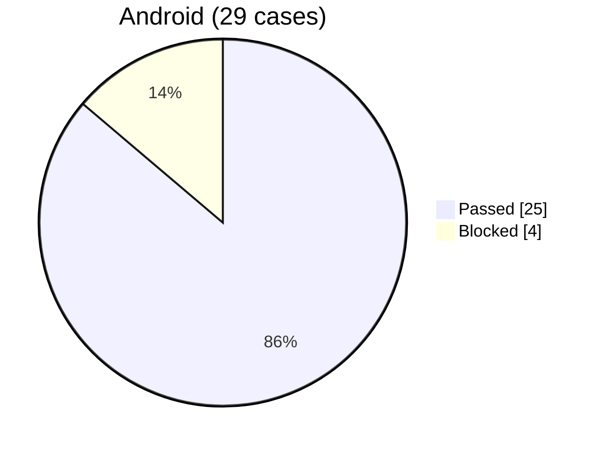
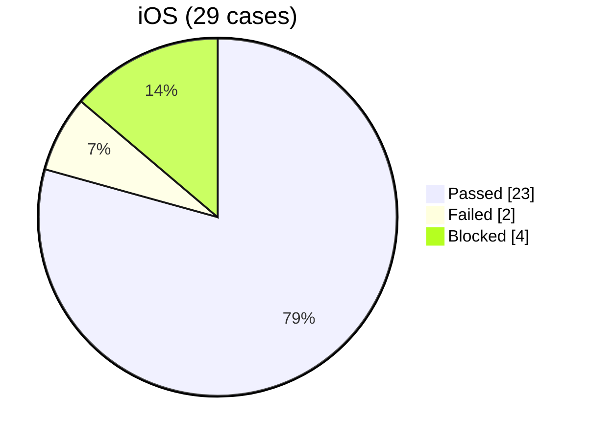

# Test Report

**Scope:** Login, Forgot Password, Sign Up
**Cases:** [TEST_CASES.md](TEST_CASES.md) · **Bugs:** [BUGS.md](BUGS.md) · **Recordings:** [Drive folder](https://drive.google.com/drive/folders/1d2D7QG8Q_hgE5EYkZ8dmdkdj6ti_2TWt?usp=sharing)

| | Android | iOS |
|---|---|---|
| Device | Pixel 8 emulator, Android 15 (API 35) | iPhone 18 Pro, iOS 27.0.1 (real device) |
| Build | Google Play | App Store 4.72.0 |
| Execution | Manual + Appium | Manual + Appium |
| Date | 21, 23 Nov 2026 | 22 Nov 2026 |

## Summary

| | Android | iOS |
|---|---|---|
| Total cases | 29 | 29 |
| Executed | 25 | 25 |
| Passed | 25 | 23 |
| Failed | 0 | 2 |
| Blocked | 4 | 4 |
| **Pass rate (executed)** | **100%** | **92%** |
| Automated tests | 21 | 21 |
| **Automation pass rate** | **100% (21/21)** | **95% (20/21)** |

### By feature

| Feature | Cases | Android pass | iOS pass | Blocked |
|---|---|---|---|---|
| Launch | 1 | 1 | 1 | 0 |
| Login | 11 | 10 | 10 | 1 |
| Forgot Password | 8 | 6 | 6 | 2 |
| Sign Up | 9 | 8 | 6 | 1 |

### Bugs

| Severity | Count | IDs |
|---|---|---|
| Medium | 2 | BUG-001, BUG-002 (both iOS) |
| Low | 6 | BUG-003 to BUG-008 |

## Expected vs actual

✅ matches expected · ❌ does not match · Blocked = not executed

### Launch and Login

| ID | Expected | Android actual | iOS actual |
|---|---|---|---|
| LCH-001 | Log in and Sign up shown | ✅ As expected | ✅ As expected |
| LGN-001 | All login elements shown | ✅ As expected | ✅ As expected |
| LGN-002 | Password hidden | ✅ As expected | ✅ As expected |
| LGN-003 | Password visible after tapping eye icon | ✅ As expected | ✅ As expected |
| LGN-004 | Required field error | ✅ "This field is required" (Mobile/Email only, BUG-007) | ✅ "This field is required" (Mobile/Email only, BUG-007) |
| LGN-005 | Invalid mobile error | ✅ "Invalid email or mobile" | ✅ "This is not a valid phone number" (BUG-003) |
| LGN-006 | "Please use correct username and password." | ✅ As expected | ✅ As expected |
| LGN-007 | Required field error under Password | ✅ As expected | ✅ As expected |
| LGN-008 | Forgot password screen opens | ✅ As expected | ✅ As expected |
| LGN-009 | Sign up screen opens | ✅ As expected | ✅ As expected |
| LGN-010 | Landing screen shown | ✅ As expected | ✅ As expected |
| LGN-011 | Home screen opens | Blocked | Blocked |

### Forgot Password

| ID | Expected | Android actual | iOS actual |
|---|---|---|---|
| FPW-001 | Field, Reset and Back shown | ✅ As expected | ✅ As expected |
| FPW-002 | Required field error | ✅ "Please enter a valid email or mobile number." (BUG-003, BUG-004) | ✅ "This field is required" (BUG-003) |
| FPW-003 | "Please enter a valid email or mobile number." | ✅ As expected | ✅ As expected |
| FPW-004 | Account not found message or recovery | ✅ Account recovery opens, asks for ID (BUG-005) | ✅ Account recovery opens, asks for ID (BUG-005) |
| FPW-005 | Back to the previous screen | ✅ Landing screen (BUG-006) | ✅ Landing screen (BUG-006) |
| FPW-006 | Log in screen shown | ✅ As expected | ✅ As expected |
| FPW-007 | ID verification starts | Blocked | Blocked |
| FPW-008 | Reset code sent | Blocked | Blocked |

### Sign Up

| ID | Expected | Android actual | iOS actual |
|---|---|---|---|
| SGN-001 | All sign up elements shown | ✅ As expected | ✅ As expected |
| SGN-002 | Mobile, Email and consent errors | ✅ All three shown | ✅ All three shown |
| SGN-003 | "Invalid number" | ✅ As expected | ✅ As expected |
| SGN-004 | "Invalid email address" | ✅ As expected | ❌ "Please enter email" (BUG-001) |
| SGN-005 | Consent error | ✅ As expected | ✅ As expected |
| SGN-006 | Consent error disappears | ✅ As expected | ✅ As expected |
| SGN-007 | Landing screen shown | ✅ As expected | ✅ As expected |
| SGN-008 | Both documents load | ✅ Both load | ❌ Terms & Conditions stays blank (BUG-002) |
| SGN-009 | OTP sent | Blocked | Blocked |

Cases marked ✅ with a bug ID passed their functional check but have a UX or consistency issue logged.

## Blocked cases

| ID | Reason |
|---|---|
| LGN-011 | Needs a registered account |
| FPW-007 | Asks for real ID details |
| FPW-008 | Needs a registered account |
| SGN-009 | Sends an OTP to a real number and creates an account |

## Recommendations

1. **Fix before release:** BUG-001 and BUG-002. Both affect iOS sign up, and BUG-002 asks users to accept terms they cannot read.
2. **Align error copy** across platforms and screens (BUG-003, BUG-004). Agree on one source of truth with BA and UX.
3. **Confirm the intended Forgot Password flow** for unregistered emails with BA (BUG-005, BUG-006). If it is meant to avoid revealing which emails are registered, document it.
4. **Provide a test account and test OTP numbers** so the 4 blocked cases can be covered.
5. **Add accessibility labels** (BUG-008) and include a screen reader pass in regression.
6. **Run the suite in CI:** hosted emulator for Android, Mac runner or device cloud for iOS.
